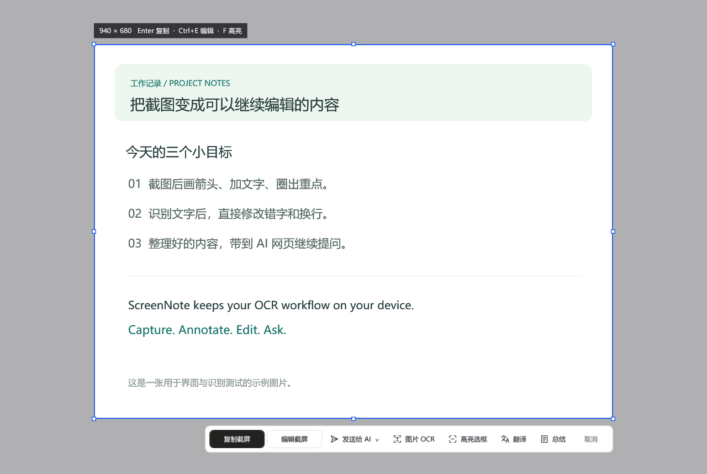
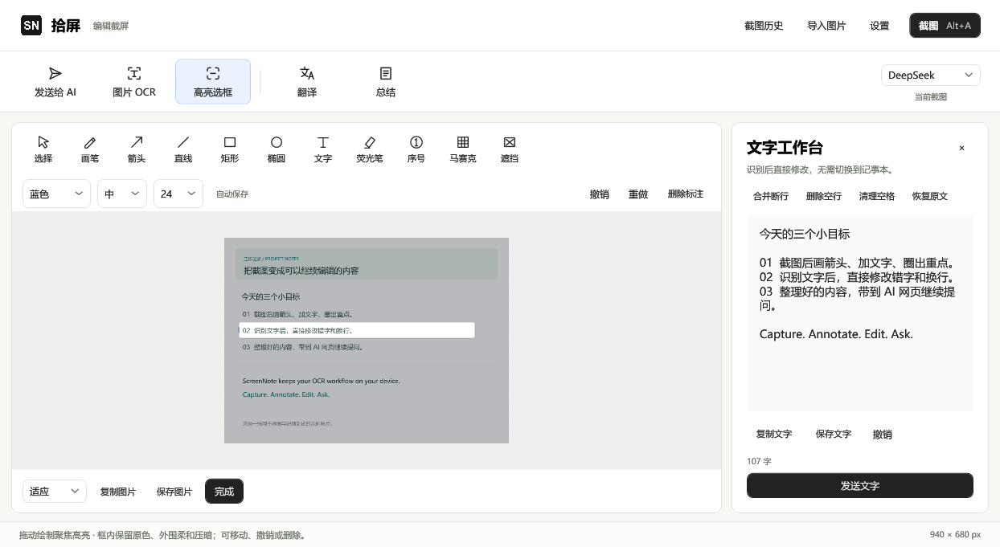
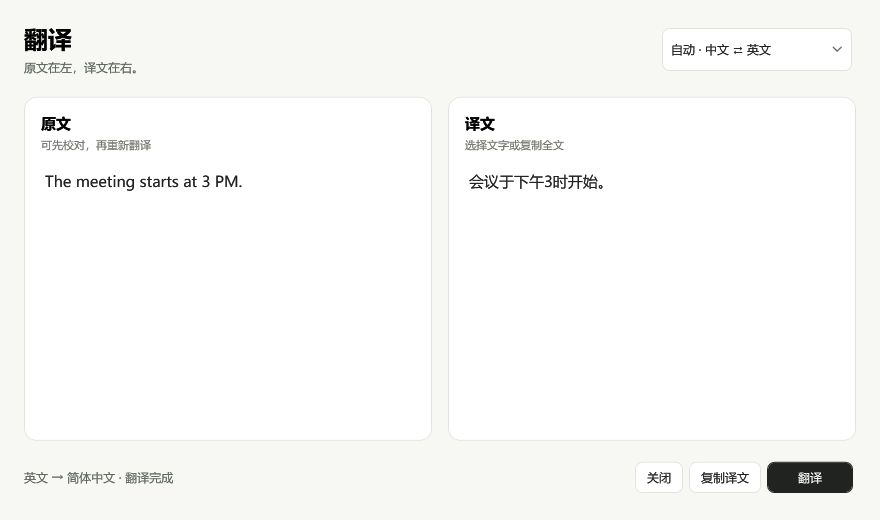
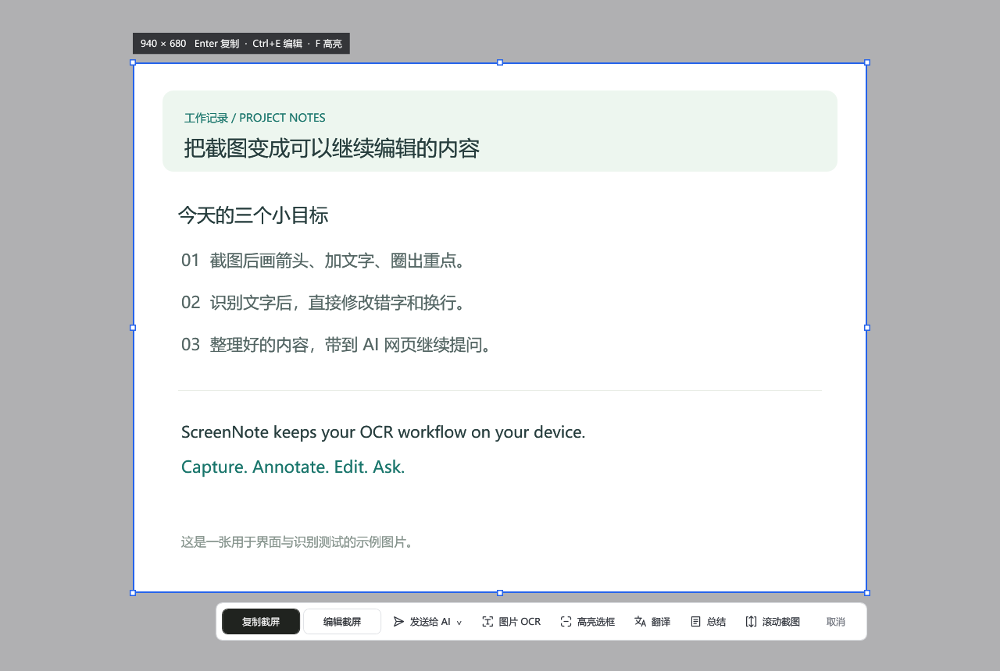
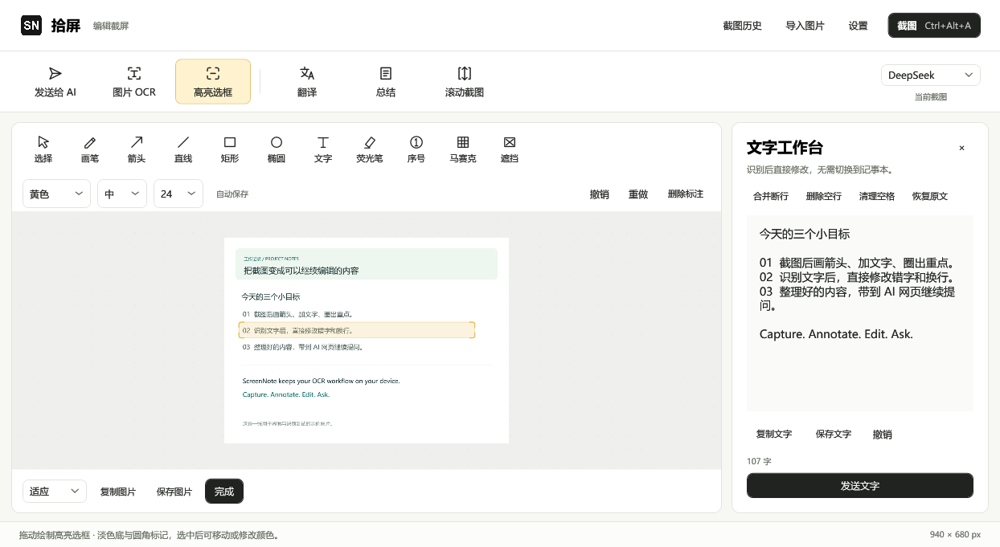
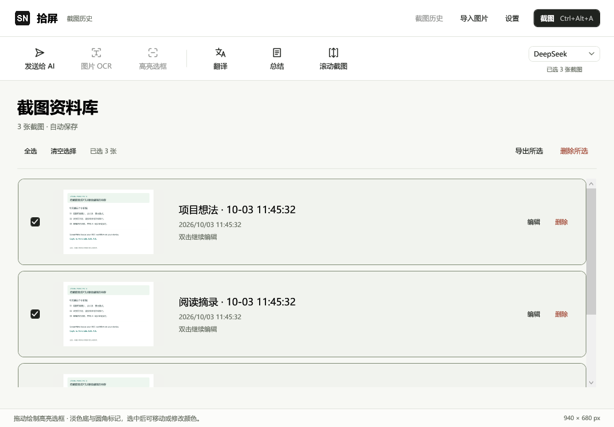
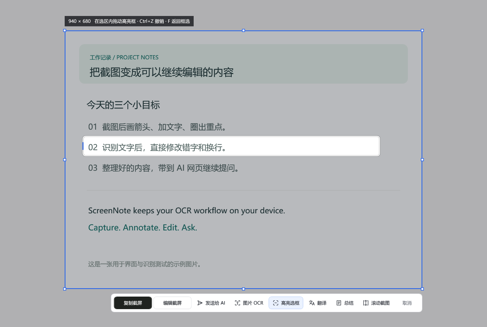

# 0.7.2 移除滚动截图

| Before | After | Why |
| --- | --- | --- |
| 截图浮动栏有九项动作 | 保留八项动作，移除滚动截图 | 减少无效入口和工具栏占用 |
| 编辑与历史顶部有滚动截图入口 | 顶部保留发送 AI、OCR、高亮、翻译、总结 | 常用操作保持清晰 |
| 后台包含滚动采集和拼接 | 删除采集窗口、拼接逻辑及相关分支 | 完整移除该功能 |

保留已有截图和长图历史。检查浮动栏在 1280／900／640px 宽度，以及主界面在 900／1040／1260px 宽度下的布局。当前截图浮动栏和编辑界面如下；后续内容为各历史版本的设计记录。

---

# 0.7.1 软件内翻译

| Before | After | Why |
| --- | --- | --- |
| 翻译将截图带到 AI 网页 | 软件内左右对照原文与译文 | 缩短操作链，直接看到结果 |
| 目标沿用 AI 网站选择 | 自动中英互译，支持明确指定方向 | 翻译方向与网页提供方分开 |
| 修改文字后可能等到旧任务结果 | 修改即取消旧任务，过时回复不显示 | 保留当前校对内容 |
| 发送 AI 时翻译一起禁用 | 本地翻译继续可用 | 独立任务保持独立响应 |
| 译文复制受短暂剪贴板占用影响 | 轻量重试，成功后给出明确反馈 | 复制结果可靠，同时避免阻塞界面 |

使用黑白、暖灰和两块圆角正文面板；保留行序和空行，长文本滚动查看。检查 880／580px 内容宽度，原文、译文、方向和页脚动作完整显示，不加高频等待动画。截图示例只使用合成材料。

---

# 0.7.0 界面品质检查

| Before | After | Why |
| --- | --- | --- |
| 占用后继续追加辅助键，四键组合难按 | 默认 Alt+A，最多三键，提供优先截图选项 | 维持简单、容易记住的操作 |
| 快捷键要求手写字符 | 点击后直接记录真实按键，Esc 放弃 | 录入值对应真实键位，减少格式猜测 |
| 发送 AI 使用隐藏在编辑区的目标 | 截图浮动栏展开三项白底圆角菜单，勾选上次目标 | 当场选择网站，保留使用习惯 |
| 滚动时弹窗占据交互 | 不激活的悬浮控制条，手动／自动滚动 | 原页面可接收滚轮，状态与完成按钮保持可见 |
| 中文识别沿用系统引擎 | 默认中文增强离线识别，设置保留系统备用 | 针对中文、小字与长图提升准确度 |

检查框选后的九项入口在 1280／900／640 宽度下全部可见；菜单字体、圆角、细边框与截图浮动栏保持一致。按键录入有焦点边框与即时反馈，保存后继续留在设置页。自动滚动从悬浮条移回内容后再发送滚轮事件，避免首次输入落在控制条。

实际验证原窗口仍可交互、真实滚轮到达正文、自动滚动与长图完成；不把样本识别率当作所有图片准确率，也不把自查当作奖项认证。

---

# 0.6.0 界面品质检查

方向：保留已选黑白 SN 图标，黑白与暖灰为主，绿灰只用于历史选中状态，琥珀色只强调当前高亮。界面精修采用 emil-design-eng 方法，高频截图与工具切换直接响应，不添加等待动画。

参考 [Linear 界面重设计](https://linear.app/now/how-we-redesigned-the-linear-ui) 对层级、对齐、颜色与不同窗口环境的检查方法，以及 [Webby 软件评审标准](https://www.webbyawards.com/judging-criteria/) 中导航、视觉、功能、交互与完整体验的维度。Awwwards、Webby、FWA 作为设计目标；自查记录不等同于奖项评审或获奖认证。

| Before | After | Why |
| --- | --- | --- |
| OCR 和发送放在编辑框底部 | 六项入口固定在顶部一级工具栏，历史与编辑共用 | 进入界面即可定位动作，减少寻找 |
| 密集文字按钮，蓝色使用缺少层级 | 同一线条图标、固定按钮规格、黑白和暖灰 | 提升统一性与识别，颜色承担明确用途 |
| 窄窗口展开 OCR 时工具换两行 | 根据可用宽度调整绘画工具尺寸 | 保留图片编辑空间，避免工具挤占画布 |
| 历史操作和每条记录都使用强边框按钮 | 记录使用低对比卡片，次级动作用轻按钮 | 内容和选中状态更突出 |
| 文字整理区与图片区不分层 | 原图点阵工作区，文字使用轻底色面板 | 更容易理解标注和文字编辑的关系 |
| 图片与提示词分步处理容易遗漏 | 同一个任务分别确认草稿与全部附件 | 翻译与总结能直接准备完整材料 |
| 设置保存后关闭窗口 | 显示保存状态，提供手动关闭入口 | 连续修改时保留位置和上下文 |
| 高亮只是荧光笔 | 新增透明圆角底、细边框和四角标记 | 框住段落时保持内容可读，重点明确 |

实际检查三轮：空资料库、历史多选、图片与 OCR 工作台；窗口宽 900／1040／1260；鼠标、键盘焦点、禁用状态；高亮导出与历史恢复；Windows 桌面滚动截图。第一轮发现空状态按钮未刷新并修复；第二轮减少次级动作边框、补充键盘焦点环和可访问名称；第三轮核对窄窗口单行绘画工具、资料保留及正式桌面版本。

示例预览与自动检查只使用合成资料，未把个人截图放入示例或 AI 网页。真实登录 AI 网站的上传兼容性、极端网页动画及横向滚动属于另行验收范围。

## 0.6.1 截图浮动栏复查

纠正一级菜单位置：六项入口出现在框选后的浮动栏，配合复制、编辑和取消，共九个直接按钮。线条图标、白色面板、黑色复制按钮统一视觉，窄屏自动换行，不折叠为二级菜单。检查逻辑宽度 1280、900、640，每个按钮保持完整可见。

高亮改为原色聚焦区域、柔和暗色外围、细白圆角线与蓝色短线；多个选框合并清晰区域，压暗只执行一次。实际代码渲染后逐项检查工具栏位置、按钮选中状态、文字对比及导出效果，原图仍独立保存。

